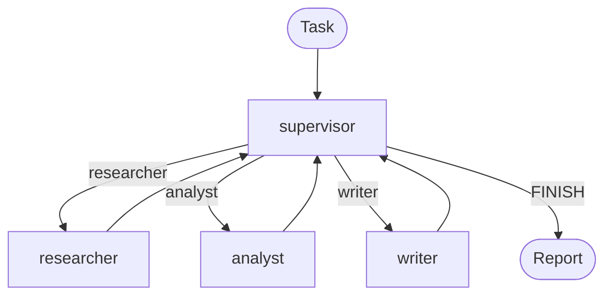

# Multi-Agent AI System (Groq)

A hierarchical multi-agent demo using Python, LangChain, LangGraph, and Groq. A **Supervisor** coordinates **Researcher**, **Analyst**, and **Writer** agents. A second **CEO / team-lead** graph shows nested routing.

## Features

- Modular agents with distinct roles
- Supervisor loop: assign tasks until `FINISH`
- Tools: DuckDuckGo search (`ddgs`) and extractive `summarize_text`
- Flat supervisor graph and CEO + research-team hierarchy
- Notebook (`notebooks/main.ipynb`) and CLI runner

## Architecture

**Supervisor team**



**Hierarchy**: CEO delegates to a research subgraph (lead → researcher / analyst) or directly to the writer.

## Setup

```bash
cd groq-multi-agent
python3 -m venv .venv
source .venv/bin/activate
pip install -r requirements.txt
pip install -e .
cp .env.example .env
# Set GROQ_API_KEY in .env
```

## Run

**CLI (supervisor graph, default):**

```bash
python -m groq_multi_agent.run "Your task here"
```

**Hierarchy graph:**

```bash
python -m groq_multi_agent.run --hierarchy "Your task here"
```

**Notebook:** open `notebooks/main.ipynb` in Jupyter or VS Code.

## Environment

| Variable | Description |
|----------|-------------|
| `GROQ_API_KEY` | Required. From [Groq Console](https://console.groq.com/). |
| `GROQ_MODEL` | Optional. Default `openai/gpt-oss-120b`. Llama 3.3 IDs are enterprise-only on Groq as of 2026; list models with `curl -s https://api.groq.com/openai/v1/models -H "Authorization: Bearer $GROQ_API_KEY"`. |
| `GROQ_TEXT_MODEL` | Optional. Default `qwen/qwen3.8-27b` when `GROQ_MODEL` is `openai/gpt-oss*`. Used for researcher/analyst/writer plain text (GPT-OSS hallucinates tools on chat). |
| `GROQ_RESEARCHER_MODE` | Optional. `auto` (default): scripted web search for `openai/gpt-oss*` (avoids bogus tool calls like `open_file`); `tools` or `scripted` to force a mode. |

**Quick verify:** `python -m groq_multi_agent.run --check`  
**Sample tasks:** `python -m groq_multi_agent.run --list-examples`

## Agentic patterns

This repo implements **25** patterns from [awesome-agentic-patterns](https://github.com/nibzard/awesome-agentic-patterns); see [docs/AGENTIC_PATTERNS.md](docs/AGENTIC_PATTERNS.md).

## Tests

```bash
pytest -v
```

Tests use a fake chat model (no network, no API key).

## Project layout

- `src/groq_multi_agent/` — agents, tools, graphs, CLI
- `notebooks/main.ipynb` — walkthrough
- `tests/` — unit and graph compile tests
